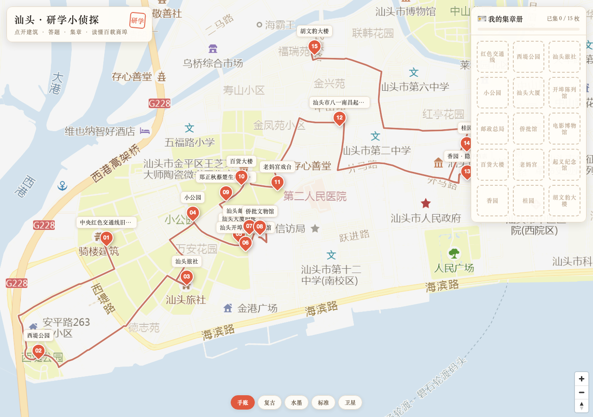
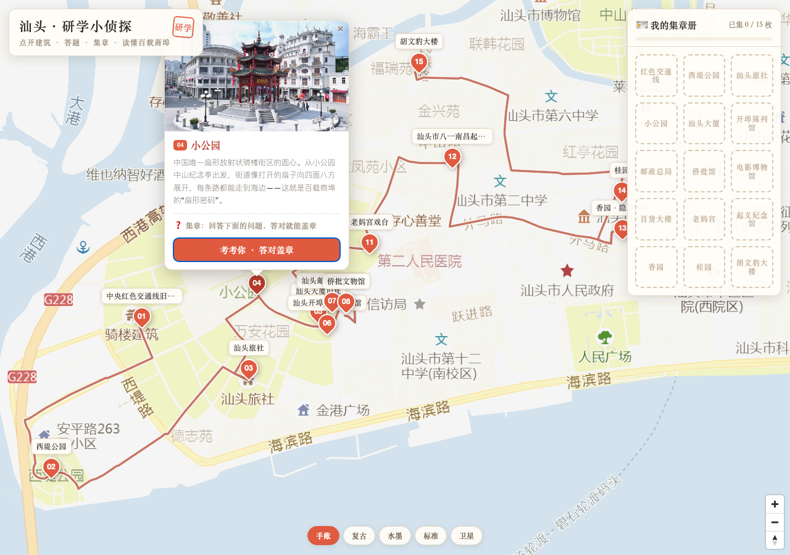
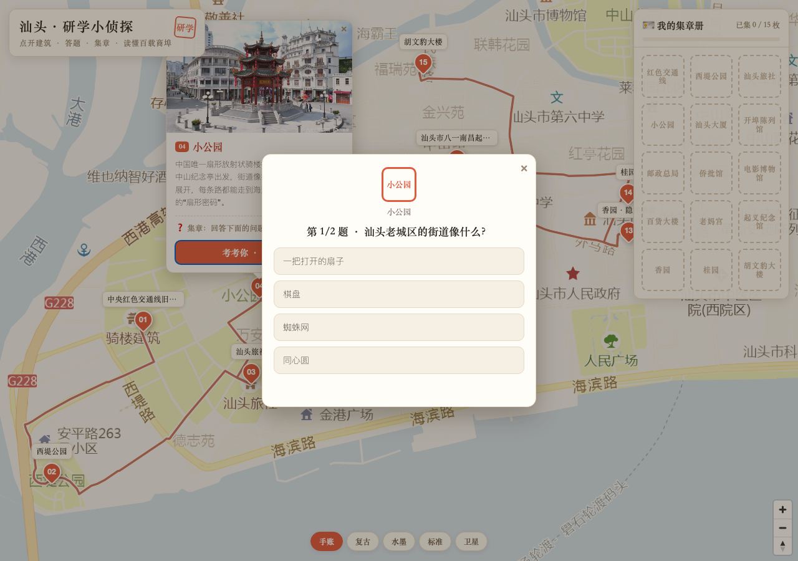
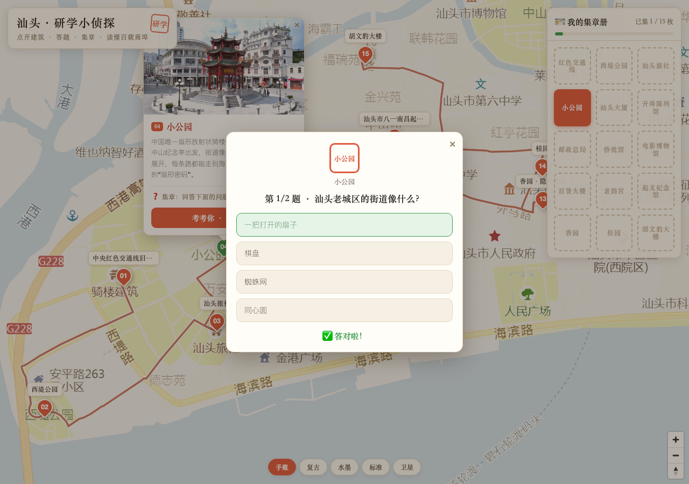
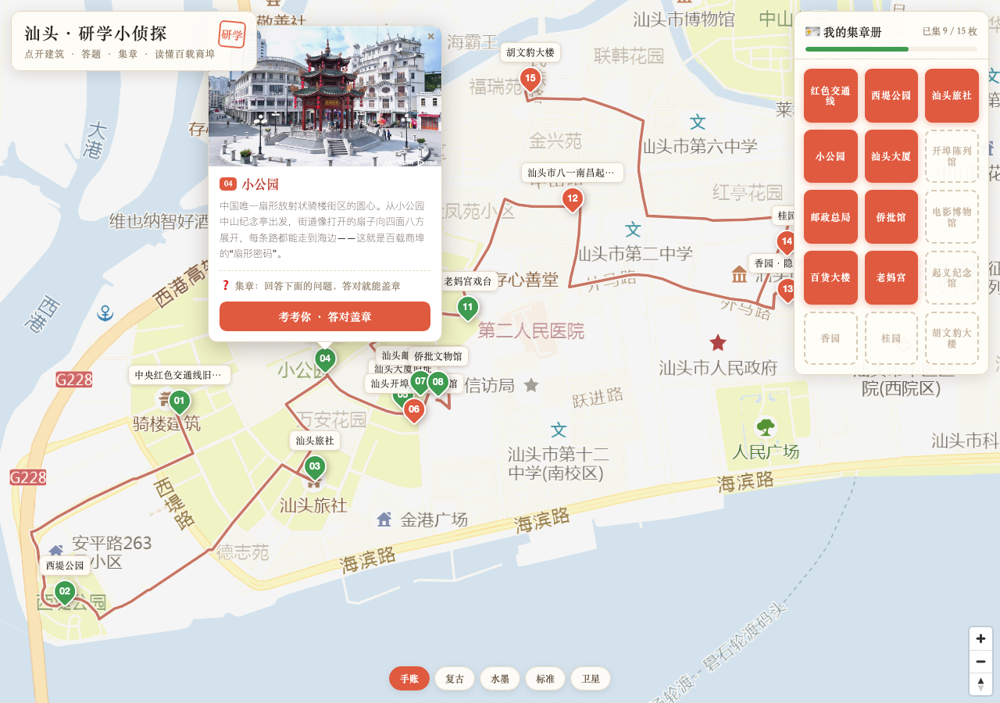
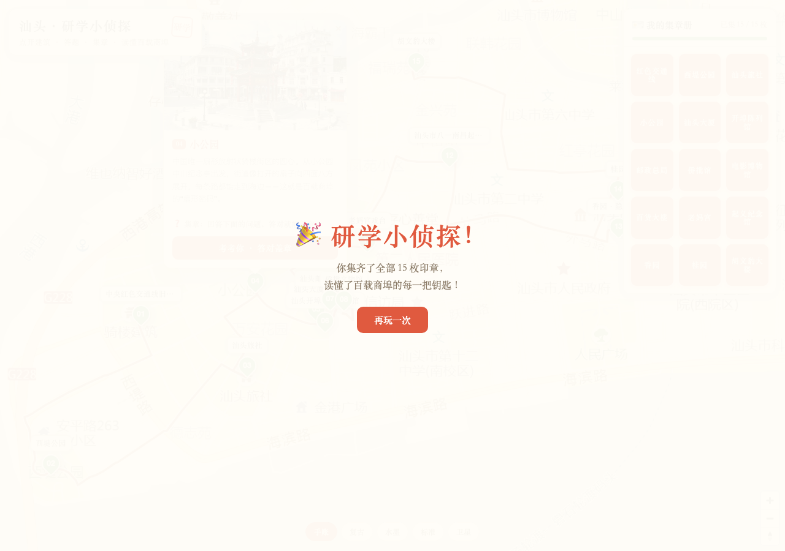

# 研学交互地图 skill · 制作笔记

> 把一本研学手册，做成孩子能「点开看、答一答、盖章奖励」的交互地图网页。
> 本文记录这套 skill 的**制作流程**与**最终效果**。

---

## 一、这是什么

一本 35 页的纯图片研学手册，没法直接给小朋友在手机上玩。这个 skill 把它变成**一个网页**：

- 地图上**点开每个建筑** → 看实景照片 + 读介绍
- 每个点**答一道题**（来自手册原文事实）→ **答对盖一枚红色印章**
- 集满全部印章 → 颁发「研学小侦探」完成页
- 进度存在浏览器里，关掉重开还能接着集

一个文件（HTML），双击即开，也能部署成线上链接发给任何人。

---

## 二、最终效果（图文）

### ① 地图总览
底部「手账/复古/水墨/标准/卫星」可切换底图风格（底图是高德瓦片）；红色路线 + 01–15 编号点位；右上角是「集章册」。



### ② 点开一个建筑
弹窗：实景照片 + 一段介绍 + 集章状态 +「考考你」按钮。



### ③ 答题
点「考考你」弹出选择题（2–4 个选项，面向 6–15 岁）。



### ④ 答对盖章
选对后绿色高亮 +「答对啦」，印章「啪」盖进集章册。



### ⑤ 集章册
右上角实时显示已集枚数 + 进度条；红章=已集，灰虚线=未集。



### ⑥ 完成页
集满 15 枚 →「研学小侦探！」完成页，可再玩一次。



---

## 三、制作流程

### 第 1 步：准备数据（4 个文件）

| 文件 | 内容 | 来源 |
|---|---|---|
| `poi.json` | 15 个点位的名称 + 经纬度 + 顺序（GCJ-02） | 用户高德收藏/坐标台账 |
| `intros.json` | 每个点 2–3 句介绍 | 研学手册逐页视觉阅读提取 |
| `quiz.json` | 每个点 1–2 道选择题 + 印章短名 | 从手册「建筑攻略/建筑侦探」事实出题 |
| `photos/` | 每个点的实景照片（`01.jpg`…） | 用户照片，压缩到长边 ≤1000px |

> 红线：坐标、介绍、题目答案都只来自真实数据，AI 不编造（同研学手册铁律）。

### 第 2 步：写地图模板 `template/study.html`

- 底图：MapLibre GL + 高德瓦片（`wprd0*.is.autonavi.com`，GCJ-02，免 key）
- 点位：编号号牌 + 名称，点击弹窗（照片 + 介绍）
- 集章册：右上角网格 + 进度条
- 答题层：全屏卡片弹层，选项大按钮
- 完成页：集满触发的祝贺页
- 风格：国潮（宋体 + 朱红 + 印章）

### 第 3 步：写生成脚本 `scripts/build_study_map.py`

把 4 类数据（poi + 介绍 + 题目 + 照片）合并成一个 JSON，照片转 base64 内嵌，替换模板里的占位符，输出**单文件 HTML**。

### 第 4 步：生成 + 验证

```sh
cd scripts
python3 build_study_map.py ../examples/shantou \
  --title "汕头·研学小侦探" --subtitle "点开建筑 · 答题 · 集章" --seal "研学" \
  --out ../examples/shantou/汕头研学交互地图.html
```

用无头浏览器验证：点位数量对、点标记出弹窗、点「考考你」出答题、点正确选项集章数 +1、无报错。

---

## 四、数据流（一张图说清）

```
poi.json（点位坐标）
intros.json（介绍）        ─┐
quiz.json（题目+印章）      ├─► build_study_map.py ─► 单文件 HTML（地图+点选+答题+集章）
photos/*.jpg（照片 base64）─┘
route.geojson（可选路线）
```

---

## 五、文件结构

```
研学交互地图skill-2026-10-17/
├── SKILL.md               # skill 说明与流程
├── 制作笔记.md            # 本文
├── template/study.html    # 交互模板（地图+答题+集章）
├── scripts/build_study_map.py  # 数据 → 单文件 HTML
├── references/汕头研学交互地图.md  # 汕头案例
└── examples/shantou/
    ├── poi.json / intros.json / quiz.json
    ├── photos/  route.geojson
    └── 汕头研学交互地图.html   # 最终交付
```

---

## 六、复现另一个城市

1. 按第 1 步准备好 4 类数据（poi/intros/quiz/photos）。
2. 把新城市放到 `examples/<城市>/`。
3. 跑一次 `build_study_map.py`（改 `--title`/`--seal`）。
4. 验证 + 交付。

题库、介绍、坐标，换一套就能做下一个城市的研学交互地图（潮州、广州骑楼、华侨文化……）。
